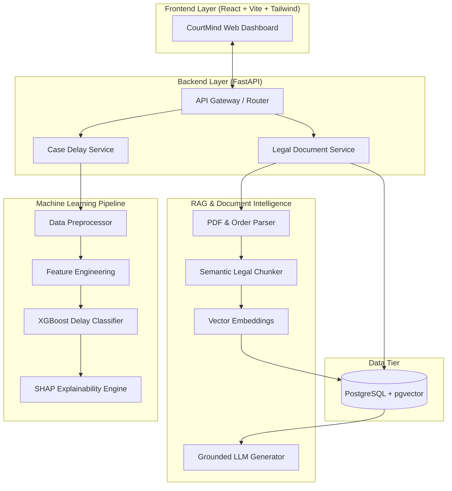

# CourtMind System Architecture

## High-Level Architecture Overview

CourtMind integrates structured judicial analytics with unstructured legal document intelligence.

## Subsystem Responsibilities

1. **Frontend**: Interactive React dashboard displaying case risk status, SHAP explanation charts, legal search, and grounded document summarization.
2. **FastAPI Backend**: High-performance asynchronous REST API handling authentication, case intake, ML inference triggering, and RAG search dispatching.
3. **ML Subsystem**: Handles structured judicial features to classify case delay risk into Low, Medium, or High categories and calculates feature contributions via SHAP.
4. **RAG Subsystem**: Ingests unstructured court rulings/orders, breaks text into semantic legal units, indexes in pgvector, and generates grounded responses via an LLM.
5. **PostgreSQL + pgvector**: Unified relational store for case metadata, user accounts, and high-dimensional vector embeddings.
